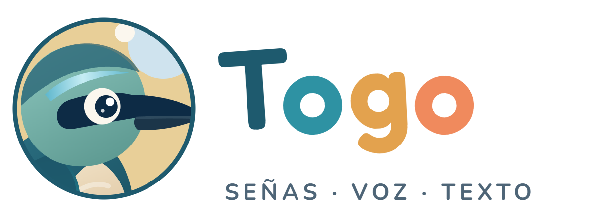
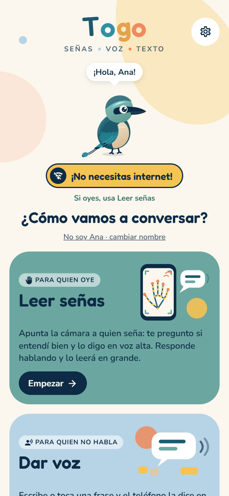
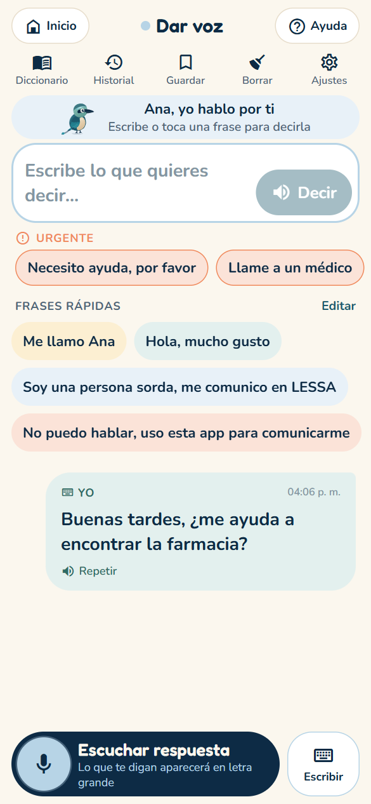
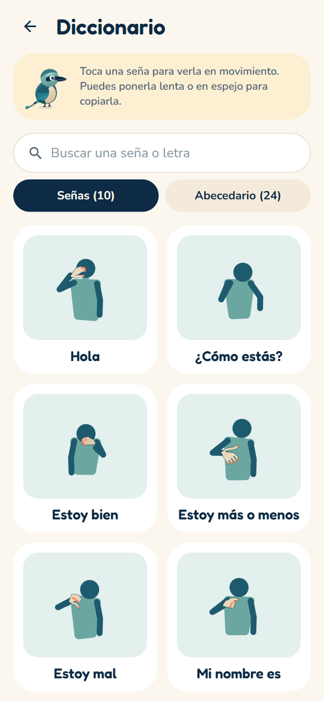
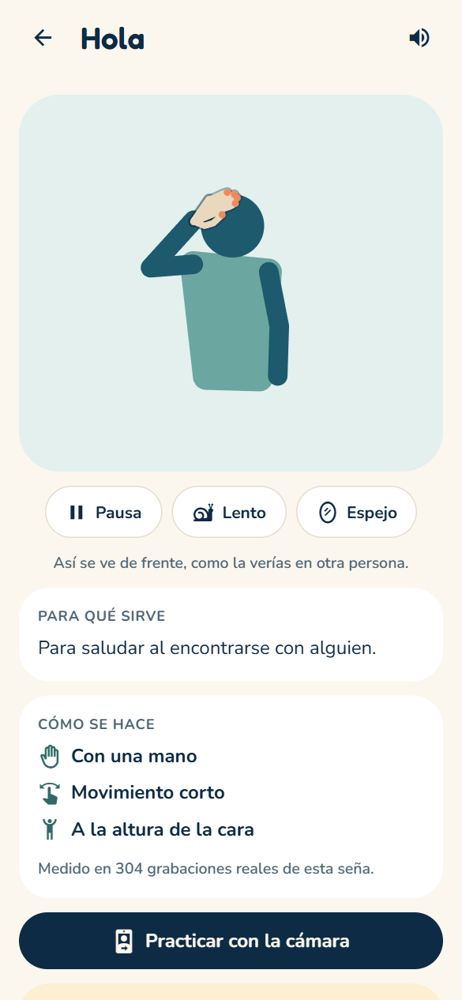
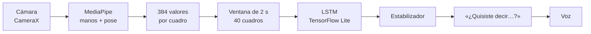

<p align="center"></p>

# Togo: Traductor de señas

**Traductor de Lengua de Señas Salvadoreña (LESSA) a voz, que funciona sin internet.**

App Android para que personas sordas y oyentes conversen en El Salvador: la cámara lee la
LESSA y el teléfono la dice en voz alta; lo que responde la otra persona aparece en letra
grande. Si alguien no puede hablar, escribe o toca una frase y el teléfono habla por esa
persona. Todo se procesa en el teléfono: ni imágenes ni voz salen del dispositivo.

**Versión Beta 0.7** · Android · Español

| Inicio | Dar voz | Diccionario LESSA | Ficha de una seña |
|:---:|:---:|:---:|:---:|
|  |  |  |  |

<sub>Capturas de la interfaz. El reconocimiento con cámara corre en la APK (módulo nativo).</sub>

## Qué hace

| Función | Para quién | Detalle |
|---|---|---|
| **Leer señas** | Quien oye | Cámara hacia quien seña → frase en curso → «¿Quisiste decir…?» → voz. Con el micrófono, la respuesta aparece en grande. |
| **Dar voz** | Quien no habla | Escribir o tocar una frase rápida → voz. «Escuchar respuesta» la muestra en letra grande. |
| **Frases urgentes** | Quien no habla | «Necesito ayuda», «Llame a un médico»… siempre a la vista, se dicen con un solo toque. |
| **Deletreo** | Ambos | Si no es una seña del vocabulario y la mano forma una letra, la letra entra: «Mi nombre es» + A-N-A → «Mi nombre es Ana». |
| **Diccionario LESSA** | Quien aprende | Cada seña animada con datos reales del dataset, en lento y en espejo; el abecedario letra por letra. «Practicar con la cámara» abre la cámara frontal para copiarla. |
| **Conversaciones guardadas** | Ambos | Se guardan a propósito, se pueden volver a escuchar o compartir como texto. |
| **Togo** | Todos | Mascota (un torogoz, ave nacional) que indica qué está pasando y da consejos. |

Reconoce **10 señas** y **27 letras** (24 estáticas; J, Ñ y Z con movimiento).

## Cómo funciona



- **En el teléfono:** un módulo nativo en Kotlin toma la cámara, detecta manos y cuerpo con
  MediaPipe, calcula las características de cada cuadro y clasifica la ventana con una red LSTM
  en TensorFlow Lite.
- **Estabilizador:** una seña solo cuenta con manos visibles, confianza y margen suficientes
  sobre la segunda opción, varias ventanas seguidas y sin repetirse sin soltarla. Así se evitan
  frases dichas por error.
- **Mismo cálculo en los dos lados:** `TOGO_DATASET/togo_features.py` (entrenamiento) y
  `Features.kt` (teléfono) calculan exactamente las mismas características.

## Resultados del modelo

| Métrica | Valor |
|---|---|
| Precisión en el conjunto de prueba | 98,1 % |
| Precisión con una persona que el modelo no vio (promedio) | **85,7 %** |
| Abecedario: letras estáticas / con movimiento | 98,0 % / 97,9 % |

«Persona no vista» significa entrenar sin una de las personas del dataset y medir con ella: es
la cifra más cercana a usar la app con alguien nuevo. El dataset actual tiene grabaciones de
tres personas más un conjunto inicial de 4000 videos. Historial de cada modelo en
[`TOGO_DATASET/models/README.md`](TOGO_DATASET/models/README.md).

**Límites conocidos:** el vocabulario es de 10 señas, y la J, Ñ y Z se grabaron con una sola
persona. Para crecer hace falta grabar a más gente que use LESSA.

## Tecnologías

| Parte | Tecnología |
|---|---|
| App | Expo SDK 57 · React Native 0.86 · TypeScript · Expo Router |
| Visión en el teléfono | Kotlin · CameraX · MediaPipe Tasks · TensorFlow Lite |
| Voz | `expo-speech` (texto a voz) · `expo-speech-recognition` (voz a texto, sin internet con el paquete de español) |
| Entrenamiento | Python 3.12 · MediaPipe · TensorFlow/Keras · scikit-learn |

## Probarla

- **En un teléfono Android:** descargar [`APK/Togo-Beta-0.7.apk`](APK/Togo-Beta-0.7.apk)
  (botón «Download raw»), abrirla en el teléfono y permitir «instalar apps desconocidas».
  Requiere Android 7 o superior con procesador de 64 bits (arm64).
- **Solo la interfaz (sin reconocimiento):**
  ```bash
  cd TOGO_MOVIL && npm install && npx expo start
  ```
  y abrirla con Expo Go. En «Leer señas», mantener presionada la cámara abre un simulador de
  señas para probar el flujo completo. También hay versión web en Docker: [`TOGO_MOVIL/DOCKER.md`](TOGO_MOVIL/DOCKER.md).
- **Compilar la APK:** [`TOGO_MOVIL/README.md`](TOGO_MOVIL/README.md).

## Estructura

| Carpeta | Qué hay |
|---|---|
| [`APK/`](APK) | La APK lista para instalar en Android |
| [`TOGO_MOVIL/`](TOGO_MOVIL/README.md) | La app: pantallas, lógica de conversación y el módulo nativo `togo-vision` |
| [`TOGO_DATASET/`](TOGO_DATASET/README.md) | Captura de videos, extracción de puntos, entrenamiento y exportación del modelo |
| [`TOGO_PANTALLA/`](TOGO_PANTALLA/README.md) | Pantalla animada para presentar el proyecto en un monitor |
| [`RETOMAR.md`](RETOMAR.md) | Cómo preparar otra computadora para seguir el proyecto |

Actualizar el modelo y la APK en un solo paso:

```bash
python TOGO_DATASET/tools/actualizar_modelo.py --apk
```

## Autor

**Elías Niriel López Casoverde** · diseño y desarrollo

Togo™ · © 2026 Elías Niriel López Casoverde. Todos los derechos reservados.
